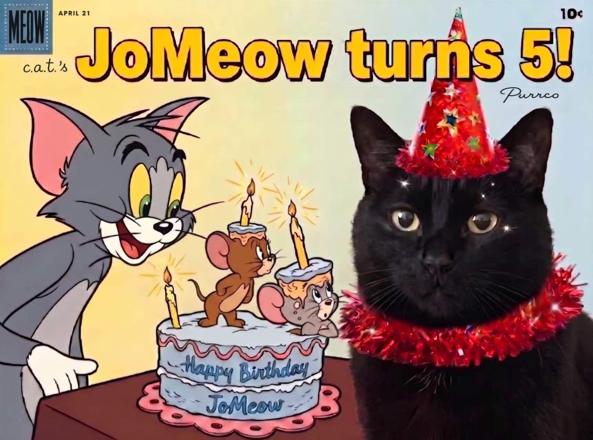

# Tom and Jerry Cat Birthday Poster

An Agent Skill that turns a photo of your cat into a vintage Tom-and-Jerry-style comic-cover birthday poster: your real cat, in a party hat, next to Tom and Jerry at the birthday cake.

*Free and open source. For personal, non-commercial celebrations only.*

## What it does

1. You upload a photo of your cat (and, if you like, a name, a headline and a canvas ratio).
2. The agent edits a bundled comic-cover template: your cat stays a real, photographic cat, with a matching party hat and collar, while Tom, Jerry and the cake keep their hand-inked cartoon look.
3. The headline and cake name are lettered in the cover's style, in the language you use.

Also supported: several cats in one poster, canvas ratios 4:3 (default), 1:1 and 3:4, revisions after delivery ("change the hat", "different headline").

## Install

Copy the `cat-birthday-poster` folder (not the whole repository) into the skills folder of your agent, for example:

- Codex: `~/.codex/skills/`
- Claude Code: `~/.claude/skills/`

On Windows, `~` is your user folder (for example `C:\Users\<you>`).

Then ask your agent for a Tom and Jerry birthday poster for your cat, and upload a clear photo.

Your agent needs to be able to view images and to edit images from reference images.

## Tested on

Codex, where it is expected to perform better than on other platforms.

## License and credits

The original material (instructions, templates, party-accessory images, documentation) is licensed as described in [LICENSE.txt](cat-birthday-poster/LICENSE.txt). Credit: JoMeow the black cat.

Tom and Jerry and related names and characters belong to their respective owners. This project is an unofficial fan creation: it is not affiliated with, endorsed by or licensed by them, and its characters are not covered by the license above. Posters made with it are for personal, non-commercial use and must not be sold, used for advertising or merchandise, or presented as official.
